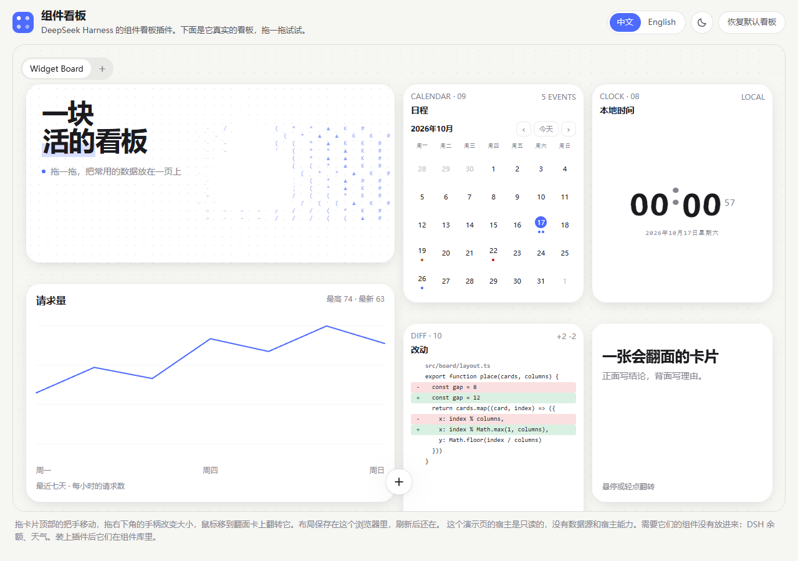
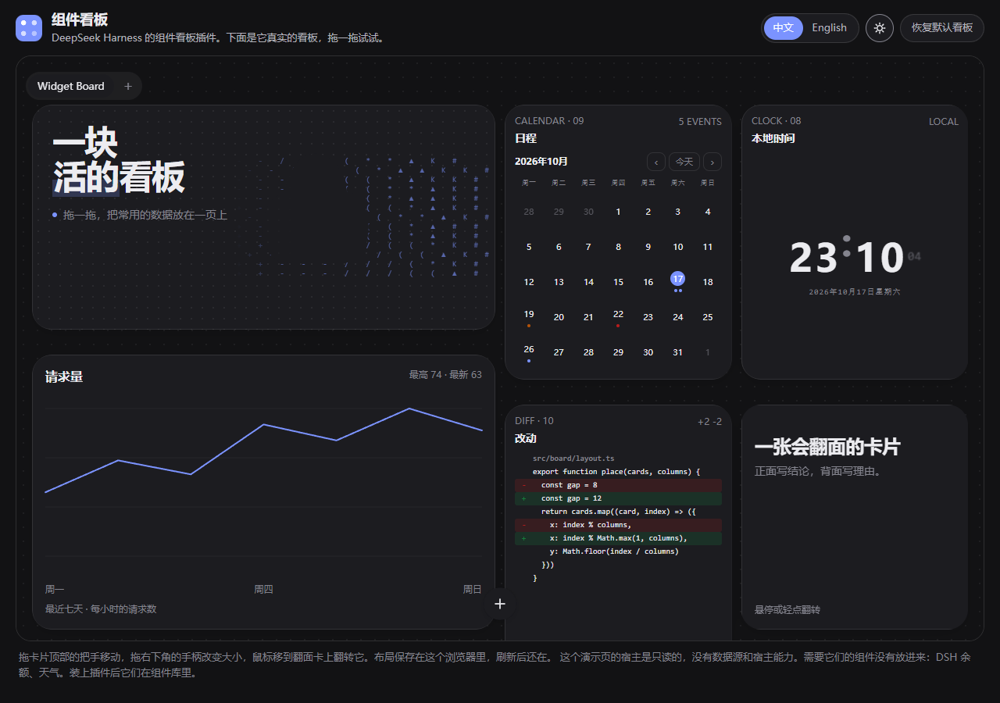

# dsh-widget-board

[中文](README.md)

A widget board for DeepSeek Harness: a page of cards you drag and resize, each card a small widget. You or the agent in a session write a widget as three files, and other plugins can provide widgets too.

**[Live demo](https://nwflower.github.io/dsh-widget-board/)** · [Install](#install) · [Write a widget](#write-a-widget) · [For plugin providers](#for-plugin-providers)

<p align="center">
  
  
</p>

<hr>

## Three files

`widget.json` names and sizes the widget; next to it sit `index.html` and `style.css`, and `main.js` when it needs a script. Built-in widgets, your own and agent-written ones share this one format. Once the files are written, the card appears in the library.

<hr>

## One sandbox

Every widget runs in its own sandboxed iframe: a strict CSP, no network and no cookies, talking to the host only over a MessagePort bridge. A grant is bound to the hash of the widget's content, so changing one byte asks a person to allow it again.

<hr>

## A few doors

| Board in the sidebar | Switch board tabs, drag and tidy cards; the default board is filled on first launch |
|---|---|
| Plus menu | Add, tidy, refresh; Add opens the floating library |
| Card gear | Change the widget's props, fill in credentials, review and grant data sources and permissions |
| Session tools | The agent lists, writes, places widgets and pushes data; `widget_show` draws one in the answer |
| `widgetBoard` service | Other plugins register widgets, data sources, actions and host capabilities |

<hr>

## Install

```sh
dsh plugin add dsh-widget-board
```

If pnpm blocks the build script, approve the `allowBuilds` line it prints and retry. The repository carries no `lib/`, so installing from GitHub (`dsh plugin add github:Nwflower/dsh-widget-board`) has the package build itself once at install time.

From a checkout:

```sh
npm install
npm run build
dsh plugin add <path to this repository>
```

<hr>

## Write a widget

Create a directory under `$DSH_HOME/widget-board/widgets/<id>/`:

```text
widget.json     name, sizes, props, data sources, credentials
index.html      the picture
style.css       styles, using only the runtime tokens
main.js         optional
samples.json    optional, one sample per size family
scripts         optional, extra scripts inlined before main.js
vendor/         optional, third-party libraries shipped with the widget (their licences kept as they are)
```

Save it and the host re-reads the library; cards on open pages switch to the new version.

<hr>

### Box

The board sizes the card. The runtime sorts the content box on two axes: `data-box-width` is `narrow`, `regular` or `wide`, `data-box-height` is `short`, `regular` or `tall`, and it exposes `--w-w`, `--w-h` and `--w-cols`. `defaultBox` is the box a new card gets; `minBox` is its lower bound.

### Look

Spacing and type sizes come from `--w-space-*` and `--w-type-*`; status colors from `--w-tone-ok`, `--w-tone-warn`, `--w-tone-danger` and `--w-tone-idle`, paired with a `.w-sr` line for screen readers. The layout primitives are `.w-frame`, `.w-actions` and `.w-scroll`; hide by size with `.w-hide-short` and `.w-hide-narrow`.

### Motion

The runtime suite owns pointer and keyboard behaviour for flip, magnetic and holographic; the widget only draws. For a flip, put `.t-flip-card` and `data-t-flip` on the outer element, `.t-flip-card__inner` inside, one `.t-flip-card__face` per side and `.t-flip-card__back` on the back; magnetic uses `.t-magnetic` with `data-t-magnetic`, holographic `.t-holo` with `data-t-holo`. The built-in `flip-card`, `magnetic-card` and `holographic-card` are copyable examples.

### Data and calls

A `source` of `provider:name` names a data source a plugin registered. `credentials` adds key fields to the settings modal; the value goes to the host's credential service and the widget cannot read it. Declare a capability in the manifest and call it with `widget.call(id, args)`; arguments and results are checked against JSON Schema. The built-in "Rest today" widget gets its account this way: add a `GITHUB_TOKEN` under Credentials and the card lists the open issues on the repositories you maintain, with no username to fill in, and a click on a row opens it in a new tab.

A widget cannot navigate or open popups itself. To send a link out, call `widget.open(url)` from inside a click handler and the page wrapping the widget opens it; only `http` and `https` addresses are accepted.

<hr>

## For plugin providers

The host half publishes the cordis service `widgetBoard` (`WIDGET_BOARD_API_VERSION = 3`):

| Method | What it does |
|---|---|
| `registerWidgetType` | Registers a widget directory; returns a handle with `provider`, `widgets`, `register` and `dispose` |
| `registerDataSource` | Registers a data source a card binds to |
| `registerAction` | Registers an action |
| `registerCapability` | Registers a host capability a widget calls with `widget.call` |

The browser half publishes the same service; `registerWidgetType({ apiVersion, provider, id, component })` registers a React component that renders a library widget of the same id. Read the version from `service.apiVersion`.

Across packages, take the type:

```ts
import type { WidgetBoardClientService } from 'dsh-widget-board/service'
```

Runtime goes through the service: no value import of this plugin, no `dsh.client.external`. When a provider is disabled or unloaded, its widgets, data sources, actions, capabilities and grants are withdrawn; its cards stay and show unavailable.

<hr>

## Status

In development; 0.1.3 is on npm. The right sidebar, the widget library page, widget version history and sharing/import are still to come.

## License

MIT
